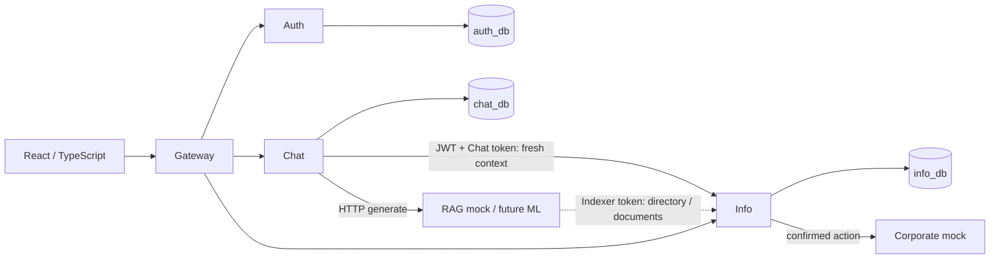

# AI Buddy — MVP Hack&Change 2026

Go-микросервисы и PostgreSQL, REST/HTTP без gRPC, React/TypeScript. **Первый контракт для совместной работы с ML — Info Service:** состав команд, бадди, владельцы технических сервисов, инструкции, шаблоны чек-листа и свежий контекст стажёра.

- [Описание Info Service и интеграция RAG](specs/info-service.md)
- [OpenAPI Info → RAG](api/openapi-info-internal.yaml), [готовые HTTP-вызовы](api/info-examples.http), [Python-клиент](examples/rag_client.py)
- [Публичный API](api/openapi-public.yaml), [Chat → RAG](api/openapi-rag-internal.yaml), [корпоративный mock](api/openapi-corporate-internal.yaml)
- [Разбор ТЗ и состояние требований](specs/case-review.md), [SDD поведения помощника](specs/agent-behavior.md)

## Демо для команды

Интерфейс устроен как чат: профиль стажёра находится слева сверху, ниже — новый чат и история. В профиле собраны личная информация, бадди, интерактивный чек-лист и заявки. Есть поиск по чатам, переименование и удаление, каталог команд/сервисов и база знаний.

Вход новых тестовых стажёров: пароль **`BuddyDemo2026!`**.

| Email | Стажёр | Команда |
| --- | --- | --- |
| `backend@buddy.test` | Егор Соколов | Backend |
| `frontend@buddy.test` | Анна Лебедева | Frontend |
| `analytics@buddy.test` | Максим Орлов | Analytics |
| `qa@buddy.test` | София Морозова | QA |
| `backend2@buddy.test` | Алина Волкова | Backend |

На экране входа можно выбрать аккаунт: поля заполнятся автоматически. Старый `intern@example.test` / `DemoPassword123!` также сохраняется.

Тестовые данные: 4 команды, 12 технических сервисов, 30 инструкций, 33 шаблона задач (15 доступных шагов для каждой команды). У новых стажёров разный начальный прогресс. Заявки и переписка индивидуальные, командные инструкции фильтруются по назначению стажёра.

Инструменты: Backend — Stash; Frontend — Figma и Storybook; Analytics — Metabase и Jupyter; QA — TestRail и тестовый стенд. Confluence и VPN — общие. Корпоративная имитация только регистрирует заявку, не выдаёт настоящий доступ.

Генератор пока **mock**, полноценного RAG/LLM здесь нет. Новая версия контракта для ML — **1.1.0**: актуальный контекст содержит `tools[]` с разрешёнными инструментами, а `suggestedAction.system` — ID из этого списка. Пример запроса: «Как получить доступ к Figma?» под аккаунтом Frontend.

Все люди и инструкции синтетические; это не реальные регламенты Авито. При `SEED_DEMO=true` Auth и Info создают согласованные демо-учётки/профили. Повторный запуск не заменяет их пароли и личный прогресс. Миграция `info/002` дополняет существующую БД без удаления переписки и заявок.

Папка `LLM-service` из исходного репозитория сохранена для работы ML-инженера.

## Где лежит код

```text
backend/
  cmd/                      # Точки входа: auth, chat, info, gateway, ragmock, corpmock, keygen
  internal/
    auth/                   # Учётные записи, сессии, ограничение попыток входа
    chat/                   # Чаты, сообщения, вызов генерации
    info/                   # Каталог команд/сервисов, инструкции, профиль, чек-лист
    gateway/                # Проверка входящих запросов и HTTP-прокси
    ragmock/                # Тестовый генератор ответов
    corpmock/               # Имитация корпоративного API
    contracts/              # Общие типы JSON между сервисами
    platform/               # Конфигурация, HTTP, JWT, PostgreSQL, жизненный цикл процесса
  migrations/
    auth/001_init.sql
    chat/001_init.sql
    info/001_init.sql
    info/002_mvp_data.sql
    embed.go                # SQL включается в бинарники через go:embed
  tests/integration/        # Сквозные проверки нескольких сервисов
  go.mod
  go.sum
api/                        # OpenAPI и примеры запросов
frontend/                   # React / TypeScript
infra/                      # Инициализация отдельных баз и ролей PostgreSQL
scripts/                    # Запуск и проверки проекта
specs/                      # SDD, разбор кейса и описание интеграции
```

Один Go-модуль содержит несколько отдельно запускаемых приложений. `cmd/<service>/main.go` выбирает приложение, а его `application.go` собирает зависимости. HTTP-маршруты находятся в `handler.go` (у Gateway — `proxy.go`), обработчики разделены по предметным функциям: например, `info/directory.go`, `info/knowledge.go`, `info/checklist.go`.

Сервисы не импортируют реализацию друг друга. Общие типы запросов и ответов находятся в `contracts`; общая инфраструктура — в `platform`. Unit-тесты лежат рядом с проверяемым пакетом, межсервисные — в `tests/integration`. Покрытие собирается с `-coverpkg=./...`, поэтому сквозные тесты учитывают код всех сервисов.

Основа организации — [официальное руководство Go по структуре модулей](https://go.dev/doc/modules/layout): точки входа в `cmd`, код приложений в `internal`, пакеты по назначению. Дополнительные слои и интерфейсы добавляются, когда для них появляется конкретная задача.

Для навигации по Info начни с `backend/internal/info/handler.go`, затем открой нужный файл функции. Схема его БД — `backend/migrations/info/001_init.sql`.

## Быстрый старт через Docker

Нужны Docker Engine/Desktop с Compose v2 и Go 1.24+ для генерации конфигурации:

```bash
bash scripts/configure.sh
docker compose up --build -d
```

Открыть http://localhost:8080. Выбрать стажёра из таблицы выше или зарегистрировать новый аккаунт. Новые регистрации автоматически получают демо-назначение Backend; роли и назначение команды не редактируются через профиль.

Если Go не установлен, сначала сгенерировать `.env` через Docker:

```bash
umask 077
docker run --rm -v "$PWD/backend:/src:ro" -w /src golang:1.24.13-alpine go run ./cmd/keygen > .env
docker compose up --build -d
```

Остановить: `docker compose down`. Именованный том с данными при этом сохраняется. Менять пароли БД после первого запуска нужно через SQL и согласованное обновление конфигурации: init-скрипт Docker выполняется только на новом томе. Не удаляйте том ради обычного перезапуска.

### Только Info Service для ML-инженера

```bash
bash scripts/configure.sh
docker compose up --build -d info
set -a
source .env
set +a
mkdir -p .local
python3 examples/rag_client.py > .local/index-snapshot.json
```

`INDEXER_SERVICE_TOKEN` даёт серверный доступ к справочнику и экспортируемым документам с ACL, **не к персональному прогрессу**. Для запросов не нужны Gateway, Auth, Chat или внешняя LLM. Info прослушивает localhost:8082 и требует сервисный токен. Не передавайте `.env` целиком коллегам: для индексатора достаточно его отдельного токена и URL.

## Без Docker

Go 1.24+, Node.js 22.12 LTS или 24 LTS, npm, PostgreSQL 14+ с `initdb`, `pg_ctl`, `psql` в PATH:

```bash
bash scripts/dev.sh
```

Интерфейс: http://localhost:5173, API Gateway: http://127.0.0.1:8080, Info: http://localhost:8082. Временные процессы и локальная БД находятся в `.local`; Ctrl+C останавливает поднятые процессы, данные остаются. Порты 8080–8085, 5173 и 55432 должны быть свободны. `DEV_PGPORT` переопределяет порт локальной БД. Локальный кластер содержит только демоданные и использует trust на loopback; не используйте этот способ для реальных данных или публичного хоста.

Сборка UI: `cd frontend && npm ci && npm run build`. Точные зависимости — `frontend/package-lock.json`, Go — `backend/go.mod` и `go.sum`. Конфигурация без секретов — `.env.example`. Сами ключи генерируются случайно и Git их игнорирует.

## Как проверить основной путь

1. Войти демопользователем, открыть «Команды»: состав, бадди и ответственные сервисы. В «Сервисы» проверить владельца каждого сервиса, перейти к его команде.
2. Спросить помощника о команде. Увидеть контекст и источник. Спросить о принципах разработки и открыть базу знаний.
3. Спросить «Как получить доступ к Stash?». Отправка заявки произойдёт только после нажатия кнопки и подтверждения диалога.
4. Увидеть номер `DEMO-...` и `submitted`; открыть «Моя адаптация» — заявка сохранена, пункт чек-листа сам не завершился.
5. Поставить/снять галочку; спросить «Какие задачи у меня остались?». Следующий шаг должен соответствовать текущему прогрессу.
6. Создать второй аккаунт — у него нет переписки и прогресса первого. Закрытый документ Analytics не виден стажёру Backend.
7. Остановить/некорректно настроить RAG: вопрос остаётся в истории, показывается ошибка и кнопка повторной генерации. Повтор не создаёт второе пользовательское сообщение.

## Автотесты и покрытие

```bash
python3 -m venv .local/qa
.local/qa/bin/pip install -r scripts/requirements-qa.txt
# Активировать окружение с валидаторами:
source .local/qa/bin/activate
bash scripts/test.sh
```

Тесты запускают отдельный временный PostgreSQL, создают изолированные тестовые БД и удаляют их после проверки. Если используется готовый **тестовый** сервер, задать `TEST_DB_ADMIN_URL`; у роли должны быть права CREATE/DROP DATABASE. Приложение и тесты не должны указывать на production. Переменная не нужна для обычного запуска.

Go-тесты: реальные SQL-миграции, HTTP-цепочка Gateway/Auth/Info/Chat, ACL, изоляция данных, повторная/конкурентная ротация refresh, идемпотентность, неизвестные действия, недоступные источники, ошибки зависимостей и пагинация; запускаются с `-race`. Frontend: вход, регистрация, контекст, диалог подтверждения, заявка, галочки, каталог, история и восстановление после ошибки. OpenAPI проверяется валидатором 3.0 и на реальных JSON-ответах интеграционных тестов.

Отчёты: `reports/backend.cover`, `backend-statements.txt`, `backend.html`, `frontend/`, `coverage-summary.json`. Go штатно считает операторы; `scripts/coverage.py` дополнительно отображает инструментированные диапазоны на непустые строки исходника, считает line coverage вместе с Vitest/V8 и требует **>80% отдельно для backend и frontend**. Команды Go включены в измерение, тесты и зависимости исключены. Измерение не заменяет тестирование реальной ML-модели.

## Архитектура и владение данными



Один сервер PostgreSQL, три логические БД и три отдельных владельца; права CONNECT других ролей отозваны. Между БД нет внешних ключей или прямого доступа. RAG не подключается к БД: статические знания забирает HTTP-клиент, актуальный пользовательский контекст получает в запросе генерации.

Auth: bcrypt, access JWT Ed25519 на 15 минут, refresh-cookie HttpOnly/SameSite Strict на 7 дней. Refresh в БД хранится хешем и ротируется атомарно. Logout отзывает refresh; уже выданный access действует до 15 минут — мгновенный глобальный отзыв пока не реализован. Приватный JWT-ключ в Compose передаётся только Auth, остальные проверяют подпись публичным ключом.

Gateway ограничивает маршруты, проверяет JWT и origin, заменяет клиентский сервисный токен и убирает поддельные заголовки идентичности. Info/Chat заново проверяют JWT и Gateway token. Внутренние контракты требуют отдельных токенов по назначению: indexer, chat context, rag generation, corporate action. `/internal` через Gateway не маршрутизируется. Чаты всегда выбираются по субъекту; команда для ACL берётся из Info, не из запроса пользователя.

В настоящем окружении потребуются корпоративное SSO вместо деморегистрации, HTTPS (`COOKIE_SECURE=true`), секрет-хранилище, ограничение ingress и ротация service tokens. Текущий rate limiter Auth — грубый предохранитель 60 попыток/минуту на адрес upstream (Gateway), не распределённый лимитер для большой нагрузки.

## Подключение RAG

ML-инженер реализует `POST /internal/v1/generate` по контракту, читает `RAG_SERVICE_TOKEN`, отвечает `answer/sources/suggestedAction/mode`. `mode=rag` означает реальный RAG. Переключение через `RAG_URL` в `.env`, затем:

```bash
docker compose up -d --force-recreate chat
```

В Docker Desktop локальный ML-сервис доступен как `http://host.docker.internal:8000`; на Linux нужна доступная контейнеру сеть/host-gateway. Внешняя LLM в основе не используется; переменные модели/провайдера/ключа и способ подключения организаторами документирует ML-сервис. Браузерный баннер честно сообщает, что текущая поставка — mock-демо; при реальном интегрировании его также нужно обновить.

Действие RAG — только предложение. Никакого доступа к корпоративному API у модели нет. Info валидирует инструмент и права заново после подтверждения; корпоративная имитация возвращает стабильный результат по ключу, Info сохраняет его. Автоматического согласования или выдачи доступа нет.

## Границы этой поставки

Воспроизводимая инженерная основа и четыре mock-сценария. До финальной сдачи команда добавляет продуктовую PDF-презентацию, видео, выбранную ML-реализацию, её внешнюю конфигурацию и evals. План метрик и соответствие условиям приведены в `specs/case-review.md`. Продуктовый эффект и ориентир UX <1 секунды в окружении жюри ещё не измерены. Redis, Kafka, стриминг и отдельный BFF не нужны для текущего пути и не включены.
